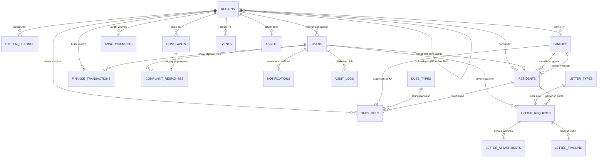

# DATABASE-SPEC — RTConnect
## Spesifikasi Rancangan Basis Data MySQL 8+

**Status:** Dokumen Rancangan Database (Phase 2 — Database Design)  
**Target RDBMS:** MySQL 8.0+  
**Storage Engine:** InnoDB  
**Karakter & Kolasi:** `utf8mb4` / `utf8mb4_unicode_ci`  
**Prinsip Desain:** Normalisasi 3NF, integritas relasional, isolasi wilayah multi-tenant (RT/RW), audit trail keuangan, dan proteksi data pribadi warga (UU PDP).

---

## 1. Diagram Hubungan Entitas (ERD)

---

## 2. Prinsip & Kebijakan Keamanan Data

1. **Pembatasan Wilayah (*Region Isolation*):**
   - Setiap transaksi, tagihan, warga, surat, dan pengaduan memiliki `region_id` (RT).
   - Pengurus tingkat RT (`ketua_rt`, `sekretaris`, `bendahara`, `petugas`) hanya memiliki hak baca/tulis untuk data dalam `region_id` RT bersangkutan.
   - Ketua RW (`ketua_rw`) memiliki hak baca agregat untuk seluruh RT di bawah RW bersangkutan.
2. **Kepatuhan Perlindungan Data Pribadi (UU PDP):**
   - Kolom sensitif: `nik` (Nomor Induk Kependudukan) dan `no_kk` (Nomor Kartu Keluarga) menggunakan ID internal sistem (`id` UUID v4) sebagai Primary Key. NIK bukan PK tabel.
   - Endpoint publik tidak mengekspos data pribadi warga.
3. **Integritas Audit Keuangan (SOT PRD 61 & USER-FLOW 73 & BUSINESS-RULES 6):**
   - Transaksi kas di tabel `finance_transactions` **tidak boleh di-hard delete**.
   - Pembatalan transaksi dilakukan melalui mekanisme *soft cancellation / void* (`status = 'void'`) dengan pencatatan `void_reason`, `voided_by_user_id`, dan waktu `voided_at`.
   - Seluruh mutasi kas dicatat dalam tabel `audit_logs`.
4. **Foreign Key Integrity:**
   - Gunakan `ON DELETE RESTRICT` pada relasi data induk penting (wilayah, warga, keluarga, jenis surat, tarif iuran) untuk mencegah *orphaned records*.
   - Gunakan `ON DELETE CASCADE` hanya pada data anak yang bergantung penuh (misal: lampiran surat ketika draf permohonan dibatalkan sebelum diproses).

---

## 3. Kamus Data & Struktur Tabel (20 Tabel)

### 3.1 Wilayah & Sistem

#### Tabel `regions`
Menyimpan hierarki wilayah rukun tetangga (RT) dan rukun warga (RW).
| Kolom | Tipe Data | Nullable | Keterangan |
| :--- | :--- | :--- | :--- |
| `id` | `VARCHAR(36)` | NO | Primary Key (UUID v4) |
| `parent_id` | `VARCHAR(36)` | YES | FK ke `regions.id` (RT merujuk ke RW-nya; RW bernilai NULL) |
| `type` | `ENUM('RW', 'RT')` | NO | Tingkatan wilayah |
| `code` | `VARCHAR(20)` | NO | Kode unik (contoh: `RW-05`, `RT-01`) |
| `name` | `VARCHAR(100)` | NO | Nama wilayah (contoh: `RT 01 / RW 05 Melati Asri`) |
| `leader_name` | `VARCHAR(100)` | YES | Nama ketua wilayah aktif |
| `created_at` | `DATETIME` | NO | Default `CURRENT_TIMESTAMP` |
| `updated_at` | `DATETIME` | NO | Default `CURRENT_TIMESTAMP ON UPDATE CURRENT_TIMESTAMP` |

#### Tabel `system_settings`
Menyimpan konfigurasi wilayah, kop surat resmi, kontak sekretariat, dan nomor rekening kas.
| Kolom | Tipe Data | Nullable | Keterangan |
| :--- | :--- | :--- | :--- |
| `id` | `VARCHAR(36)` | NO | Primary Key |
| `region_id` | `VARCHAR(36)` | NO | FK ke `regions.id` |
| `setting_key` | `VARCHAR(50)` | NO | Kunci pengaturan (contoh: `letter_header`, `bank_account`, `contact_center`) |
| `setting_value` | `JSON` | NO | Nilai konfigurasi dalam format JSON terstruktur |
| `updated_by_user_id` | `VARCHAR(36)` | YES | FK ke `users.id` yang memperbarui konfigurasi |
| `updated_at` | `DATETIME` | NO | Default `CURRENT_TIMESTAMP ON UPDATE CURRENT_TIMESTAMP` |

---

### 3.2 Autentikasi & Pengguna

#### Tabel `users`
Akun login sistem untuk seluruh pengurus dan warga.
| Kolom | Tipe Data | Nullable | Keterangan |
| :--- | :--- | :--- | :--- |
| `id` | `VARCHAR(36)` | NO | Primary Key (UUID v4) |
| `email` | `VARCHAR(100)` | NO | Alamat email unik untuk login |
| `password_hash` | `VARCHAR(255)` | NO | Hash kata sandi (Argon2id atau bcrypt) |
| `role` | `ENUM('super_admin', 'ketua_rw', 'ketua_rt', 'sekretaris', 'bendahara', 'petugas', 'warga')` | NO | Peran kewenangan |
| `region_id` | `VARCHAR(36)` | YES | FK ke `regions.id` (cakupan wilayah akses pengguna) |
| `resident_id` | `VARCHAR(36)` | YES | FK ke `residents.id` (relasi ke profil warga jika role = warga) |
| `name` | `VARCHAR(100)` | NO | Nama lengkap pengguna |
| `phone` | `VARCHAR(20)` | YES | Nomor telepon/WhatsApp |
| `avatar_url` | `VARCHAR(255)` | YES | Tautan foto profil |
| `is_active` | `BOOLEAN` | NO | Default `TRUE` |
| `last_login_at` | `DATETIME` | YES | Waktu terakhir login |
| `created_at` | `DATETIME` | NO | Default `CURRENT_TIMESTAMP` |
| `updated_at` | `DATETIME` | NO | Default `CURRENT_TIMESTAMP ON UPDATE CURRENT_TIMESTAMP` |

#### Tabel `user_refresh_tokens`
Menyimpan token refresh untuk sesi otentikasi JWT yang aman.
| Kolom | Tipe Data | Nullable | Keterangan |
| :--- | :--- | :--- | :--- |
| `id` | `VARCHAR(36)` | NO | Primary Key |
| `user_id` | `VARCHAR(36)` | NO | FK ke `users.id` |
| `token_hash` | `VARCHAR(255)` | NO | Hash token refresh |
| `expires_at` | `DATETIME` | NO | Waktu kedaluwarsa token |
| `revoked_at` | `DATETIME` | YES | Waktu pencabutan token (logout) |
| `created_at` | `DATETIME` | NO | Default `CURRENT_TIMESTAMP` |

---

### 3.3 Kependudukan (Warga & KK)

#### Tabel `families`
Menyimpan data Kartu Keluarga (KK).
| Kolom | Tipe Data | Nullable | Keterangan |
| :--- | :--- | :--- | :--- |
| `id` | `VARCHAR(36)` | NO | Primary Key |
| `no_kk` | `CHAR(16)` | NO | Nomor KK 16 digit (UNIQUE) |
| `head_resident_id` | `VARCHAR(36)` | YES | FK ke `residents.id` (Kepala Keluarga) |
| `region_id` | `VARCHAR(36)` | NO | FK ke `regions.id` (RT domisili KK) |
| `address` | `TEXT` | NO | Alamat lengkap domisili |
| `created_at` | `DATETIME` | NO | Default `CURRENT_TIMESTAMP` |
| `updated_at` | `DATETIME` | NO | Default `CURRENT_TIMESTAMP ON UPDATE CURRENT_TIMESTAMP` |

#### Tabel `residents`
Menyimpan data identitas individu kependudukan.
| Kolom | Tipe Data | Nullable | Keterangan |
| :--- | :--- | :--- | :--- |
| `id` | `VARCHAR(36)` | NO | Primary Key |
| `family_id` | `VARCHAR(36)` | YES | FK ke `families.id` |
| `nik` | `CHAR(16)` | NO | NIK 16 digit (UNIQUE) |
| `no_kk` | `CHAR(16)` | NO | Nomor Kartu Keluarga |
| `name` | `VARCHAR(100)` | NO | Nama lengkap sesuai KTP |
| `gender` | `ENUM('Laki-laki', 'Perempuan')` | NO | Jenis kelamin |
| `birth_place` | `VARCHAR(50)` | NO | Tempat lahir |
| `birth_date` | `DATE` | NO | Tanggal lahir |
| `religion` | `ENUM('Islam', 'Kristen', 'Katolik', 'Hindu', 'Buddha', 'Konghucu', 'Lainnya')` | NO | Agama |
| `job` | `VARCHAR(50)` | NO | Pekerjaan |
| `marital_status` | `ENUM('Belum Kawin', 'Kawin', 'Cerai Hidup', 'Cerai Mati')` | NO | Status perkawinan |
| `family_role` | `ENUM('Kepala Keluarga', 'Istri', 'Anak', 'Famili Lain')` | NO | Kedudukan dalam keluarga |
| `status_domisili` | `ENUM('Tetap', 'Kontrak', 'Kost', 'Sementara')` | NO | Status tinggal |
| `status_kependudukan` | `ENUM('Aktif', 'Pindah', 'Meninggal', 'Nonaktif')` | NO | Status administratif |
| `phone` | `VARCHAR(20)` | YES | Nomor kontak / WhatsApp |
| `region_id` | `VARCHAR(36)` | NO | FK ke `regions.id` (RT wilayah) |
| `address` | `TEXT` | NO | Alamat tempat tinggal |
| `created_at` | `DATETIME` | NO | Default `CURRENT_TIMESTAMP` |
| `updated_at` | `DATETIME` | NO | Default `CURRENT_TIMESTAMP ON UPDATE CURRENT_TIMESTAMP` |

---

### 3.4 Layanan Administrasi Surat

#### Tabel `letter_types`
Master katalog jenis surat pengantar dan keterangannya.
| Kolom | Tipe Data | Nullable | Keterangan |
| :--- | :--- | :--- | :--- |
| `id` | `VARCHAR(36)` | NO | Primary Key |
| `code` | `VARCHAR(20)` | NO | Kode surat (contoh: `SK-DOM`, `SP-KTP`, `SKTM`, `SKU`, `SIK`) (UNIQUE) |
| `name` | `VARCHAR(100)` | NO | Nama resmi surat keterangan |
| `description` | `TEXT` | YES | Deskripsi kegunaan surat |
| `requirements` | `JSON` | YES | Daftar dokumen prasyarat yang harus dilampirkan pemohon |
| `processing_time` | `VARCHAR(50)` | YES | Estimasi durasi penyelesaian (contoh: `1 - 2 Hari Kerja`) |
| `is_active` | `BOOLEAN` | NO | Default `TRUE` |
| `created_at` | `DATETIME` | NO | Default `CURRENT_TIMESTAMP` |
| `updated_at` | `DATETIME` | NO | Default `CURRENT_TIMESTAMP ON UPDATE CURRENT_TIMESTAMP` |

#### Tabel `letter_requests`
Pencatatan permohonan surat warga dan riwayat persetujuannya.
| Kolom | Tipe Data | Nullable | Keterangan |
| :--- | :--- | :--- | :--- |
| `id` | `VARCHAR(36)` | NO | Primary Key |
| `reference_no` | `VARCHAR(50)` | NO | Nomor referensi acak sistem (contoh: `REQ/2026/08/0014`) (UNIQUE) |
| `letter_type_id` | `VARCHAR(36)` | NO | FK ke `letter_types.id` |
| `resident_id` | `VARCHAR(36)` | NO | FK ke `residents.id` (pemohon) |
| `region_id` | `VARCHAR(36)` | NO | FK ke `regions.id` (RT pemohon) |
| `purpose` | `TEXT` | NO | Keperluan pengajuan surat |
| `letter_number` | `VARCHAR(100)` | YES | Nomor surat resmi registrasi pengurus |
| `status` | `ENUM('Draft', 'Diajukan', 'Perlu Revisi', 'Diproses', 'Disetujui', 'Ditolak', 'Selesai')` | NO | Status verifikasi |
| `reviewed_by_user_id` | `VARCHAR(36)` | YES | FK ke `users.id` (Sekretaris yang memverifikasi) |
| `approved_by_user_id` | `VARCHAR(36)` | YES | FK ke `users.id` (Ketua RT yang menyetujui) |
| `notes` | `TEXT` | YES | Catatan verifikasi atau alasan penolakan/revisi |
| `created_at` | `DATETIME` | NO | Default `CURRENT_TIMESTAMP` |
| `updated_at` | `DATETIME` | NO | Default `CURRENT_TIMESTAMP ON UPDATE CURRENT_TIMESTAMP` |

#### Tabel `letter_attachments`
Dokumen lampiran pendukung permohonan surat.
| Kolom | Tipe Data | Nullable | Keterangan |
| :--- | :--- | :--- | :--- |
| `id` | `VARCHAR(36)` | NO | Primary Key |
| `letter_request_id` | `VARCHAR(36)` | NO | FK ke `letter_requests.id` (ON DELETE CASCADE) |
| `file_name` | `VARCHAR(255)` | NO | Nama file dokumen asli |
| `file_path` | `VARCHAR(255)` | NO | Lokasi path penyimpanan aman |
| `file_size` | `INT UNSIGNED` | NO | Ukuran berkas (dalam bytes) |
| `mime_type` | `VARCHAR(100)` | NO | Tipe MIME berkas (image/jpeg, application/pdf) |
| `created_at` | `DATETIME` | NO | Default `CURRENT_TIMESTAMP` |

#### Tabel `letter_timeline`
Rekam jejak tahapan verifikasi pengajuan surat (*audit timeline*).
| Kolom | Tipe Data | Nullable | Keterangan |
| :--- | :--- | :--- | :--- |
| `id` | `VARCHAR(36)` | NO | Primary Key |
| `letter_request_id` | `VARCHAR(36)` | NO | FK ke `letter_requests.id` (ON DELETE CASCADE) |
| `status` | `VARCHAR(50)` | NO | Status tahapan |
| `note` | `TEXT` | YES | Catatan ringkas status |
| `actor_user_id` | `VARCHAR(36)` | YES | FK ke `users.id` yang memproses tahapan |
| `created_at` | `DATETIME` | NO | Default `CURRENT_TIMESTAMP` |

---

### 3.5 Keuangan Buku Kas & Audit

#### Tabel `finance_transactions`
Pencatatan kas masuk dan kas keluar lingkungan RT/RW.
| Kolom | Tipe Data | Nullable | Keterangan |
| :--- | :--- | :--- | :--- |
| `id` | `VARCHAR(36)` | NO | Primary Key |
| `transaction_code` | `VARCHAR(50)` | NO | Kode unik transaksi (contoh: `TRX-202608-001`) (UNIQUE) |
| `region_id` | `VARCHAR(36)` | NO | FK ke `regions.id` (RT pemilik kas) |
| `date` | `DATE` | NO | Tanggal kejadian transaksi |
| `type` | `ENUM('in', 'out')` | NO | `in` = Kas Masuk, `out` = Kas Keluar |
| `category` | `VARCHAR(100)` | NO | Kategori transaksi kas |
| `amount` | `DECIMAL(15,2)` | NO | Nominal transaksi dalam Rupiah |
| `description` | `TEXT` | NO | Rincian keperluan transaksi |
| `recorded_by_user_id`| `VARCHAR(36)` | NO | FK ke `users.id` (Bendahara pencatat) |
| `receipt_url` | `VARCHAR(255)` | YES | Tautan foto kuitansi/nota/struk |
| `status` | `ENUM('active', 'void')`| NO | Default `'active'`. Transaksi tidak dihapus fisik |
| `void_reason` | `TEXT` | YES | Alasan pembatalan/void jika status = void |
| `voided_by_user_id` | `VARCHAR(36)` | YES | FK ke `users.id` yang melakukan void |
| `voided_at` | `DATETIME` | YES | Waktu pembatalan dilakukan |
| `audit_note` | `TEXT` | YES | Catatan koreksi audit bila terjadi pengubahan data |
| `created_at` | `DATETIME` | NO | Default `CURRENT_TIMESTAMP` |
| `updated_at` | `DATETIME` | NO | Default `CURRENT_TIMESTAMP ON UPDATE CURRENT_TIMESTAMP` |

#### Tabel `audit_logs`
Pencatatan jejak audit mutasi data sensitif dan transaksi keuangan.
| Kolom | Tipe Data | Nullable | Keterangan |
| :--- | :--- | :--- | :--- |
| `id` | `BIGINT UNSIGNED` | NO | Primary Key (AUTO_INCREMENT) |
| `table_name` | `VARCHAR(50)` | NO | Nama tabel target mutasi |
| `record_id` | `VARCHAR(36)` | NO | ID entitas yang dimutasi |
| `action` | `ENUM('INSERT', 'UPDATE', 'DELETE', 'VOID')` | NO | Jenis mutasi |
| `old_values` | `JSON` | YES | Nilai sebelum perubahan |
| `new_values` | `JSON` | YES | Nilai sesudah perubahan |
| `user_id` | `VARCHAR(36)` | YES | FK ke `users.id` eksekutor mutasi |
| `ip_address` | `VARCHAR(45)` | YES | Alamat IP pengguna |
| `created_at` | `DATETIME` | NO | Default `CURRENT_TIMESTAMP` |

---

### 3.6 Iuran Warga & Tagihan

#### Tabel `dues_types`
Master jenis tarif iuran lingkungan.
| Kolom | Tipe Data | Nullable | Keterangan |
| :--- | :--- | :--- | :--- |
| `id` | `VARCHAR(36)` | NO | Primary Key |
| `region_id` | `VARCHAR(36)` | NO | FK ke `regions.id` |
| `code` | `VARCHAR(20)` | NO | Kode tarif (contoh: `IUR-KEB`, `IUR-KMN`) |
| `name` | `VARCHAR(100)` | NO | Nama tarif iuran |
| `amount` | `DECIMAL(12,2)` | NO | Besaran nominal per unit |
| `billing_type` | `ENUM('per_kk', 'per_resident')` | NO | Dasar pengenaan tagihan |
| `billing_period`| `ENUM('Bulanan', 'Tahunan', 'Sekali')` | NO | Frekuensi penagihan |
| `description` | `TEXT` | YES | Penjelasan peruntukan iuran |
| `is_active` | `BOOLEAN` | NO | Default `TRUE` |
| `created_at` | `DATETIME` | NO | Default `CURRENT_TIMESTAMP` |
| `updated_at` | `DATETIME` | NO | Default `CURRENT_TIMESTAMP ON UPDATE CURRENT_TIMESTAMP` |

#### Tabel `dues_bills`
Tagihan iuran yang diterbitkan kepada warga atau kartu keluarga per periode.
| Kolom | Tipe Data | Nullable | Keterangan |
| :--- | :--- | :--- | :--- |
| `id` | `VARCHAR(36)` | NO | Primary Key |
| `bill_number` | `VARCHAR(50)` | NO | Nomor tagihan resmi (contoh: `TAG-202608-0014`) (UNIQUE) |
| `dues_type_id` | `VARCHAR(36)` | NO | FK ke `dues_types.id` |
| `period` | `VARCHAR(30)` | NO | Periode tagihan (contoh: `Agustus 2026`) |
| `amount` | `DECIMAL(12,2)` | NO | Total nominal tagihan |
| `due_date` | `DATE` | NO | Tanggal jatuh tempo pembayaran |
| `resident_id` | `VARCHAR(36)` | NO | FK ke `residents.id` (penanggung jawab bayar) |
| `family_id` | `VARCHAR(36)` | YES | FK ke `families.id` |
| `region_id` | `VARCHAR(36)` | NO | FK ke `regions.id` |
| `status` | `ENUM('Belum Dibayar', 'Menunggu Verifikasi', 'Lunas', 'Terlambat', 'Ditolak', 'Dibatalkan')` | NO | Status penagihan |
| `payment_method`| `VARCHAR(50)` | YES | Metode (Transfer Bank BCA, Tunai, dsb.) |
| `payment_date` | `DATETIME` | YES | Waktu warga membayar / konfirmasi |
| `payment_proof_url` | `VARCHAR(255)`| YES | Tautan unggahan foto struk bukti bayar |
| `verified_by_user_id`| `VARCHAR(36)`| YES | FK ke `users.id` (Bendahara pemeriksa) |
| `verified_at` | `DATETIME` | YES | Waktu konfirmasi disetujui/ditolak |
| `verification_notes` | `TEXT` | YES | Catatan verifikasi atau kuitansi manual |
| `created_at` | `DATETIME` | NO | Default `CURRENT_TIMESTAMP` |
| `updated_at` | `DATETIME` | NO | Default `CURRENT_TIMESTAMP ON UPDATE CURRENT_TIMESTAMP` |

---

### 3.7 Komunikasi, Aduan, Agenda, Inventaris & Notifikasi

#### Tabel `announcements`
Warta dan pengumuman resmi pengurus RT/RW.
| Kolom | Tipe Data | Nullable | Keterangan |
| :--- | :--- | :--- | :--- |
| `id` | `VARCHAR(36)` | NO | Primary Key |
| `title` | `VARCHAR(255)` | NO | Judul pengumuman |
| `content` | `TEXT` | NO | Isi lengkap pengumuman |
| `target_region`| `VARCHAR(100)` | NO | Target sasaran (contoh: `Semua RT (RW 05)`, `RT 01`) |
| `priority` | `ENUM('Biasa', 'Penting', 'Mendesak')` | NO | Tingkat urgensi |
| `status` | `ENUM('Draft', 'Dipublikasikan', 'Diarsipkan')` | NO | Status publikasi |
| `publish_date` | `DATETIME` | NO | Tanggal & waktu publikasi aktif |
| `valid_until` | `DATE` | YES | Tanggal akhir masa berlaku informasi |
| `author_user_id`| `VARCHAR(36)` | NO | FK ke `users.id` (Pengurus pembuat) |
| `region_id` | `VARCHAR(36)` | NO | FK ke `regions.id` (asal wilayah) |
| `created_at` | `DATETIME` | NO | Default `CURRENT_TIMESTAMP` |
| `updated_at` | `DATETIME` | NO | Default `CURRENT_TIMESTAMP ON UPDATE CURRENT_TIMESTAMP` |

#### Tabel `complaints`
Pencatatan keluhan fasilitas umum, sampah, ketertiban, dan aspirasi warga.
| Kolom | Tipe Data | Nullable | Keterangan |
| :--- | :--- | :--- | :--- |
| `id` | `VARCHAR(36)` | NO | Primary Key |
| `title` | `VARCHAR(255)` | NO | Judul singkat aduan |
| `category` | `VARCHAR(50)` | NO | Kategori (Fasilitas Umum, Kebersihan, Keamanan, dsb.) |
| `location` | `VARCHAR(255)` | NO | Lokasi spesifik titik kejadian/masalah |
| `description` | `TEXT` | NO | Penjelasan rinci masalah |
| `reporter_id` | `VARCHAR(36)` | YES | FK ke `residents.id` (pelapor terdaftar) |
| `reporter_name`| `VARCHAR(100)` | NO | Nama pelapor |
| `reporter_phone`| `VARCHAR(20)` | YES | Nomor kontak pelapor |
| `region_id` | `VARCHAR(36)` | NO | FK ke `regions.id` (wilayah kejadian) |
| `status` | `ENUM('Baru', 'Ditinjau', 'Ditindaklanjuti', 'Selesai', 'Ditolak')` | NO | Status penanganan |
| `assigned_to` | `VARCHAR(100)` | YES | Nama/jabatan petugas yang didelegasikan |
| `photo_url` | `VARCHAR(255)` | YES | Tautan foto kondisi di lapangan |
| `created_at` | `DATETIME` | NO | Default `CURRENT_TIMESTAMP` |
| `updated_at` | `DATETIME` | NO | Default `CURRENT_TIMESTAMP ON UPDATE CURRENT_TIMESTAMP` |

#### Tabel `complaint_responses`
Tanggapan resmi pengurus atas aduan warga.
| Kolom | Tipe Data | Nullable | Keterangan |
| :--- | :--- | :--- | :--- |
| `id` | `VARCHAR(36)` | NO | Primary Key |
| `complaint_id` | `VARCHAR(36)` | NO | FK ke `complaints.id` (ON DELETE CASCADE) |
| `author_name` | `VARCHAR(100)` | NO | Nama dan peran pengurus penjawab |
| `message` | `TEXT` | NO | Teks tanggapan atau instruksi tindak lanjut |
| `created_at` | `DATETIME` | NO | Default `CURRENT_TIMESTAMP` |

#### Tabel `events`
Jadwal kegiatan kemasyarakatan, posyandu, kerja bakti, dan rapat warga.
| Kolom | Tipe Data | Nullable | Keterangan |
| :--- | :--- | :--- | :--- |
| `id` | `VARCHAR(36)` | NO | Primary Key |
| `title` | `VARCHAR(255)` | NO | Nama kegiatan |
| `category` | `VARCHAR(50)` | NO | Kategori agenda |
| `event_date` | `DATE` | NO | Tanggal pelaksanaan |
| `time_string` | `VARCHAR(50)` | NO | Rentang waktu (contoh: `07:00 - 10:30 WIB`) |
| `location` | `VARCHAR(255)` | NO | Lokasi tempat acara |
| `organizer` | `VARCHAR(100)` | NO | Penyelenggara kegiatan |
| `description` | `TEXT` | YES | Keterangan dan imbauan untuk warga |
| `status` | `ENUM('Akan Datang', 'Berlangsung', 'Selesai', 'Dibatalkan')` | NO | Status kegiatan |
| `attendees_count` | `INT UNSIGNED`| NO | Perkiraan jumlah peserta (Default: `0`) |
| `region_id` | `VARCHAR(36)` | NO | FK ke `regions.id` |
| `created_at` | `DATETIME` | NO | Default `CURRENT_TIMESTAMP` |
| `updated_at` | `DATETIME` | NO | Default `CURRENT_TIMESTAMP ON UPDATE CURRENT_TIMESTAMP` |

#### Tabel `assets`
Pencatatan inventaris barang sarana dan prasarana lingkungan.
| Kolom | Tipe Data | Nullable | Keterangan |
| :--- | :--- | :--- | :--- |
| `id` | `VARCHAR(36)` | NO | Primary Key |
| `code` | `VARCHAR(30)` | NO | Kode unik barang inventaris (contoh: `AST-TND-01`) (UNIQUE) |
| `name` | `VARCHAR(150)` | NO | Nama barang / fasilitas |
| `category` | `VARCHAR(50)` | NO | Kategori barang |
| `quantity` | `INT UNSIGNED` | NO | Jumlah barang |
| `unit` | `VARCHAR(20)` | NO | Satuan (Unit, Buah, Set, Meter) |
| `condition_status` | `ENUM('Baik', 'Perlu Perbaikan', 'Rusak')` | NO | Kondisi fisik barang |
| `location` | `VARCHAR(150)` | NO | Tempat penyimpanan aset |
| `pic` | `VARCHAR(100)` | NO | Penanggung jawab (PIC) |
| `notes` | `TEXT` | YES | Catatan spesifikasi/kelengkapan |
| `region_id` | `VARCHAR(36)` | NO | FK ke `regions.id` |
| `created_at` | `DATETIME` | NO | Default `CURRENT_TIMESTAMP` |
| `updated_at` | `DATETIME` | NO | Default `CURRENT_TIMESTAMP ON UPDATE CURRENT_TIMESTAMP` |

#### Tabel `notifications`
Penyimpanan notifikasi in-app untuk warga dan pengurus (BUSINESS-RULES Section 11).
| Kolom | Tipe Data | Nullable | Keterangan |
| :--- | :--- | :--- | :--- |
| `id` | `VARCHAR(36)` | NO | Primary Key |
| `user_id` | `VARCHAR(36)` | NO | FK ke `users.id` (penerima notifikasi) |
| `title` | `VARCHAR(150)` | NO | Judul singkat notifikasi |
| `message` | `TEXT` | NO | Pesan notifikasi |
| `type` | `ENUM('info', 'success', 'warning', 'error')` | NO | Jenis notifikasi |
| `link_tab` | `VARCHAR(50)` | YES | Navigasi cepat tab aplikasi (contoh: `surat`, `iuran`) |
| `is_read` | `BOOLEAN` | NO | Default `FALSE` |
| `created_at` | `DATETIME` | NO | Default `CURRENT_TIMESTAMP` |

---

## 4. Indeks & Optimasi Kueri

1. **Pencarian Cepat Data Warga:**
   - `idx_residents_nik`: `nik` (Unique)
   - `idx_residents_name_rt`: `(region_id, name)`
   - `idx_residents_family`: `family_id`
2. **Antrean Verifikasi Surat:**
   - `idx_letters_status_region`: `(region_id, status)`
   - `idx_letters_reference`: `reference_no` (Unique)
3. **Pencegahan Tagihan Ganda:**
   - `uk_dues_subjek_period`: `(dues_type_id, resident_id, period)`
4. **Buku Kas & Saldo Periode:**
   - `idx_finance_region_date`: `(region_id, date, status)`
